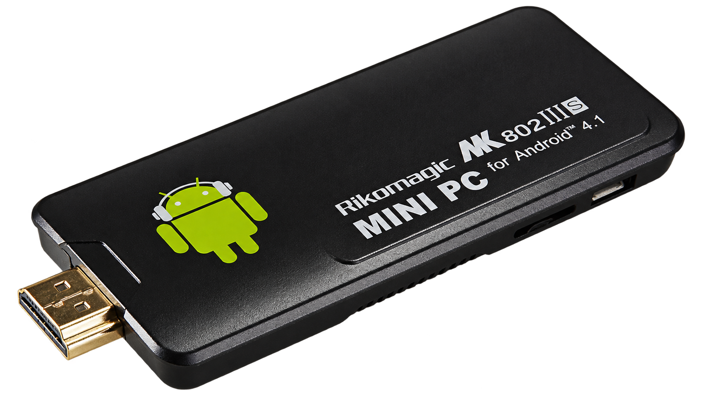
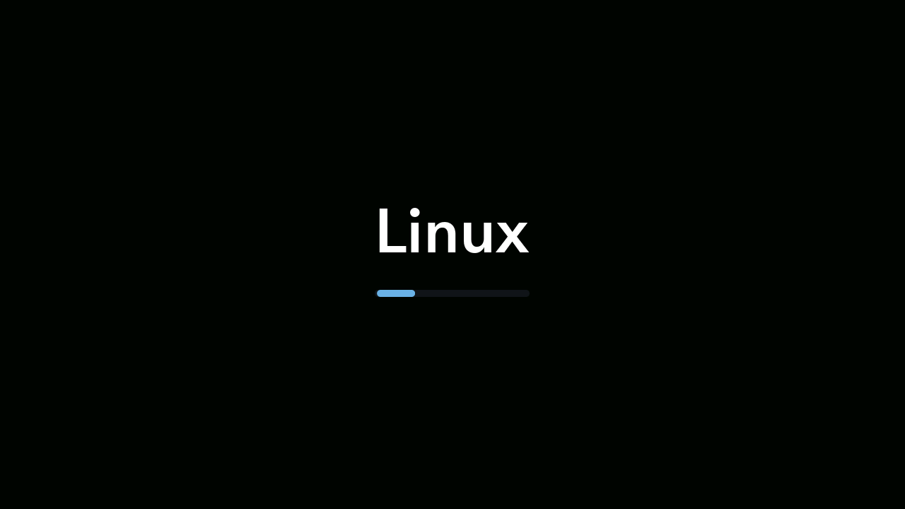
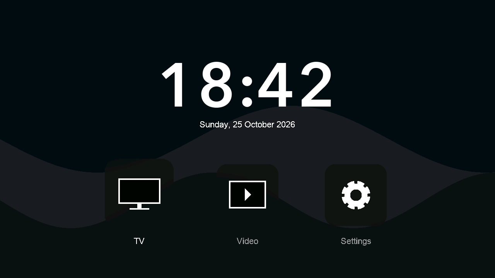
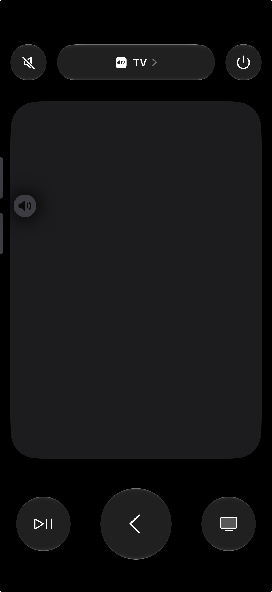

# Linux on a Rikomagic MK802 IIIS

Hi. I had an old HDMI stick, an old television, and almost no experience with
embedded Linux. I wanted to see whether I could give the stick another use
with help from an AI. Most of the experiment happened over two days, followed
by more debugging.

I used GPT-6.1 Sol, mostly on High, through Codex. It investigated the hardware
and wrote the code. I connected cables, pressed Reset more times than I would
have liked, and tested what appeared on the television.

## First, a way in

The MK802 IIIS is from around 2013. Inside are a Rockchip RK3066 with two
Cortex-A9 cores, 1 GiB of RAM and 4 GiB of NAND. Mine was running Android 4.2.2
on Linux 3.0.36+. Its mouse-driven tablet interface and old browser were not
particularly useful on a television anymore.

I had no microSD card, Ethernet adapter or serial console. There was a MacBook,
a USB cable and Rockchip Loader mode. We started by reading and checking a
backup, then tried small pieces of code in RAM before attempting Linux.

That took longer than I expected. A memory-read bug added an address twice.
The stick kept switching off, which turned out to be the Loader's idle timer.
Getting code into RAM was only part of the problem: handing control to the
kernel also meant dealing with caches, memory setup and clocks.

Eventually, the television said **Linux RAM**.

The next goal was Wi-Fi and SSH. Once those worked, the stick could stay beside
the TV while development continued over the network. We added persistent
application updates too, so trying another version no longer meant reconnecting
the USB cable every time. The system eventually booted from internal NAND and
worked with the stick powered by a USB charger.

## Then, something to use on the TV

A basic launcher followed within a few hours of the first useful Linux boot.
Compared with bringing up the hardware, that part moved surprisingly quickly.
The system grew to include AirPlay, hardware-assisted H.264 playback and control
through the iPhone's Apple TV Remote. Text entry eventually used the phone's
own keyboard, after extending the remote library's protocol support.

Keeping it all working was harder than adding the next feature. Some videos
failed. Sound could drift out of sync or break after pausing. Hardware decoding
still needed the right buffers, timestamps and display layers. There were also
complete freezes with stripes on the screen, sometimes while the stick was
idle. We did not find the cause of every problem.

## Why such an old Linux?

Other people had brought Linux to this family of devices long before this
experiment. The [PicUntu notes](https://github.com/sgjava/byoc/wiki/PicUntu)
were helpful, but their installation route expected a card I did not have,
and Wi-Fi hardware varied between boards.

We kept the vendor kernel because it already supported this particular board.
A newer kernel would have needed another round of work on booting, drivers and
board configuration. The result was a small musl-based Linux system using
3.0.36+, rather than a current Debian installation.

## What is in this repository?

The code here covers the first useful milestone: **standalone Linux with Wi-Fi
and SSH**. It includes the Cortex-A9 userspace build, MT5931 initialization,
network and key configuration, boot-image packaging and a USB RAM uploader.
The later launcher, player, AirPlay receiver and phone remote are not included.

This build was tested on my MK802 IIIS: it booted in RAM, connected to Wi-Fi
and accepted SSH login with an interactive shell. It needs a compatible device
and its own stock backup for the kernel, Wi-Fi driver and firmware.
[Build and run](TECHNICAL.md#build-and-run) covers setup, RAM boot, installation
to NAND and the results of the hardware checks.

## What I took from it

I still do not know whether I will use it regularly as a TV box. It could just
as well become a small Linux machine at home. But getting this far without
knowing where to start was already interesting.

Almost everything underneath came from other people's work: Linux, BusyBox,
musl, Dropbear, media libraries and years of research into undocumented
protocols. I am grateful to the people who built and documented those pieces.
The AI helped me connect those pieces to a device I would not have known how
to work with on my own. That still involved plenty of mistakes and debugging.

---

[Technical notes and upstream credits](TECHNICAL.md). Code and text are
[MIT](LICENSE), except the GPL ARM handoff and kernel patch material.
Third-party images and marks retain their separate rights.
